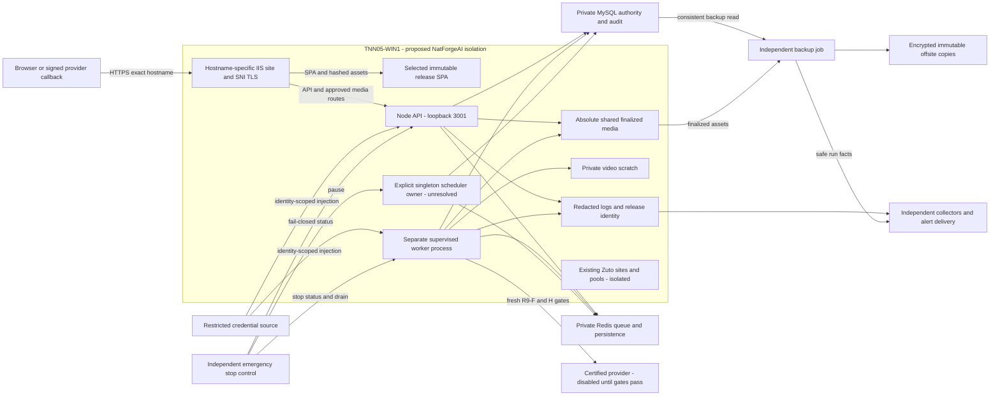
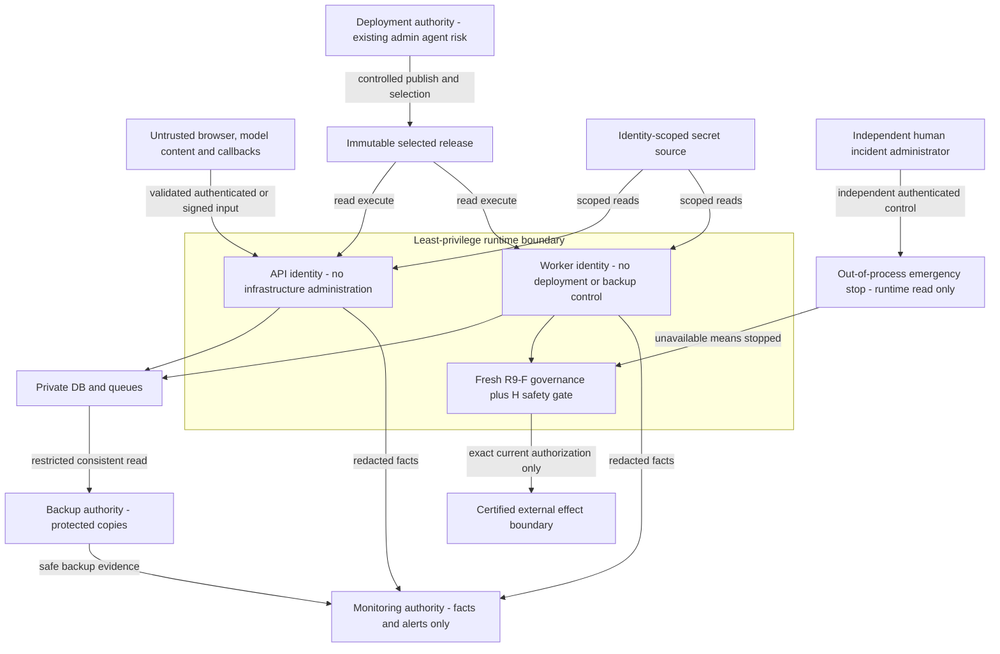

# R10-A A02 production platform architecture specification

Status: DOCUMENTED DESIGN; NOT DEPLOYED. Baseline: `799f6b4cb351ebe969f97da606324605fdf2a07b`, branch `feature/r10-a-production-platform`. This specifies requirements independent of a deployment script, service-wrapper product or provisioned database location. It authorizes no implementation or live activation. A03 has not begun.

## 1. Evidence and design status

`M2` means the current A02 mission: operator-verified host facts and approved storage-remediation direction. `REPO` means static behavior inspected at the frozen baseline, not an application execution. `DESIGN` means required target architecture or a proposed concrete choice, not installed state. `UNKNOWN` means a dependency or approval still lacking evidence. Source IDs for B-H and R9 resolve in the accepted [A01 catalog](r10-a-a01-sources.json); additional repository evidence and A01 input hashes are in [A02 sources](r10-a-a02-sources.json). A01-A16 and D01-D12 remain local planning identifiers. M2 authorizes this broader architecture specification under A02 without renumbering A01's narrower host-prerequisite label.

| Status | Evidence / limit |
|---|---|
| M2 observed by operator | TNN05-WIN1; Windows Server 2022 Standard x64; 6 logical processors; 31.89 GB RAM, 18.72 GB available at inspection. Available RAM is a time-specific observation, not reserved capacity |
| M2 observed by operator | IIS running; Zuto sites have separate application pools and HTTPS SNI; public IPv4 41.185.71.10. NatForgeAI proxy modules, hostname binding and port availability not verified |
| M2 observed by operator | Node.js 26.13.0 and npm 11.20.0 installed; application, native binaries and package compatibility unproven |
| M2 observed by operator | `D:\www\natforgeai` exists; remaining NatForgeAI directories not provisioned; no deployed NatForgeAI application |
| M2 observed by operator | Azure DevOps agents use an administrator-privileged deployer identity; forbidden as NatForgeAI runtime |
| M2 observed by operator | Afrihost DNS is editable but points to previous hosting; win-acme renews four Zuto certificates; NatForgeAI certificate not issued |
| DESIGN approved direction | Windows/IIS, loopback API 3001, separately supervised workers, immutable releases, absolute shared media, private video scratch and stable references |
| UNKNOWN | MySQL/Redis hosting/version/private routes/persistence, disk capacity, supervisor product, certificate challenge method, collector/alert infrastructure, identity provisioning and operational signatories |

No OneGrid connection occurred in A02. Historical PM2, Linux backup examples, old paths and old migration counts in earlier documentation are not observed facts for this new installation. Sibling readiness verdicts describe their offline work, not an integrated release here. R9-REPORT's build/environment limitations qualify R9-HANDOFF's broad offline-green summary; H's later sibling results do not modify this baseline.

## 2. Component and interface design

All nodes and edges below are target interfaces unless labeled existing Zuto. Private DB/Redis placement is deliberately outside the host box: it is undecided whether private endpoints are local or remote. No endpoint names, accounts or secrets are invented.

IIS serves the selected release's `dist/public` SPA. Proposed routing retains `/api/*`, `/generated/*` and `/uploads/*` proxying to Node at `127.0.0.1:3001`. Internal plain HTTP is loopback only; public HTTP is solely a hostname-specific HTTPS redirect or approved certificate challenge. No generic wildcard site or default binding may capture Zuto traffic. Use a dedicated NatForgeAI application pool/site identity and exact-host SNI certificate; `natforgeai.com` is the intended primary hostname, while `www` and any other aliases require an explicit decision (D01/D08). Never reuse a Zuto certificate, pool, renewal definition, global rewrite or physical root. F-CONTRACT section 8's generic 3000 differs from actual boot/web.config and M2's 3001; preserve this documented variance for F/X review.

`REPO`: boot binds 127.0.0.1:3001 (PORT override); Vite's 3000 is development-only. `public/web.config` contains proxy/SPA and static cache rules, not an installed IIS site, issued certificate or complete production hardening. ARR/URL Rewrite availability, Host/header forwarding trust, TLS 1.2+ policy, HSTS rollout, body limits, allowed verbs, dotfile/backup blocking and external port closure all need review and live gates. Node currently sets a 50 MiB body limit; matching IIS limits and any reductions remain decisions. Correct proxy treatment must preserve OAuth redirect host, signed webhook raw bodies, cookies and HTTPS origin without trusting arbitrary client forwarding headers. Existing webhook routes are not automatically certified D adapters.

## 3. Process ownership and unresolved conflict

| Role | REPO behavior | DESIGN owner / unresolved change |
|---|---|---|
| API entry | `api/boot.ts` creates HTTP/tRPC, OAuth and webhook routes; production block starts loopback server and media/SPA middleware | One API process initially, supervised separately; A owns service plan, X coordinates unassigned entry-point changes |
| Publishing/content consumers | Production + configured Redis in boot starts both; `api/worker.ts` also starts both after Redis connection | Worker process should be sole consumer role for the initial target topology; application separation not implemented or assigned |
| Consumer singleton | `api/lib/queue/bullmq.ts` stores worker handles in module variables; each factory call constructs a new worker without a repeated-start guard | Stored handles are not singleton construction guards. Repeated construction can overwrite the retained handle; running both entries creates additional consumers. Neither proves duplicate external effects, but both require lifecycle/concurrency control |
| Publishing fallback | Boot's else branch starts `startPublishingRunner`; production `env.ts` requires Redis, so missing production Redis fails import rather than establishing a supported production fallback | No production fallback or degraded auto-dispatch inferred; require explicit role configuration and failure posture |
| Credit renewal | Boot unconditionally starts scheduler; scheduler schedules an initial delayed pass and daily interval | Single designated owner required; API initially hosts it only if explicitly accepted. No standalone scheduler entry exists in the inspected package |
| Metrics observation | Boot starts it if enabled; `env.ts` defaults enabled unless explicitly false | Must explicitly disable during initial inert staging or authorize separately; contrary historical default-off descriptions must not be reused |
| Lifecycle / social polling | Boot conditionally starts each; env defaults off | Remain disabled until separately authorized; choose singleton owner and stop behavior |
| Startup reconciliation | Boot fires approval-continuation, engagement-continuation and engagement-reconciliation sweeps without a boot flag | API start is not an inert health probe. Classify/control these startup effects before first execution; do not claim an env-only switch exists |
| Standalone shutdown | Worker registers SIGINT/SIGTERM, closes publishing/content workers and BullMQ connection | Service wrapper must deliver a tested graceful stop; verify all client connections and child render processes close, not merely assume process exit equals drain |
| API shutdown | No corresponding coordinated shutdown handler in inspected boot entry | API timers/consumers/sweeps and in-flight requests need a composed drain/stop plan; unassigned application work via X |
| R10-C/D/H production composition | Sibling contracts provide dormant mechanisms, not a merged and deployed worker | X owns coordination and canonical migration convergence; actual composition implementer unresolved; no runtime-resilience or H binding claimed for legacy workers |

The embedded-versus-standalone worker conflict is **OPEN and deployment-blocking** (D02/D12; A08/A09). Do not solve it by starting both, omitting Redis, relying on module singletons, or disabling unrelated safety checks. Deliberate replicas could be designed later with bounded concurrency and real-DB proofs; this document does not approve them. An IIS recycle, API restart or Azure pipeline run must not silently become worker/scheduler activation.

Safe startup requires identity/secret validation, compatible release/schema, private dependencies, independent stop state, required telemetry/backup evidence and explicit role ownership before claims or external effects. API import currently starts work before HTTP readiness, so a future composition change is needed for an inert startup gate; no application start is authorized here. Configure production explicitly; do not use dev mode as a safety mechanism.

Safe shutdown must stop intake and scheduler admissions, drain and fence claims, allow bounded in-flight completion, preserve `UNCERTAIN`/pending results, close queues/clients and terminate child render processes safely. Timeout leads to preserved uncertainty and governed reconciliation, not automatic redispatch. C-CONTRACT's lease/dispatch barrier and fresh R9-F authority remain mandatory; legacy BullMQ publishing retries (three attempts in inspected defaults) do not certify compliance with C/D/H. Restart backoff, crash-loop ceiling, shutdown budget, service recovery identity and Windows reboot behavior remain D02 choices requiring drill evidence.

## 4. Storage and persistence design

Only the root exists. The following are proposed names beneath `D:\www\natforgeai`, not provisioned directories or newly approved environment variable names (D03/D04):

| Proposed logical area | Purpose / write boundary | Persistence and reference rules |
|---|---|---|
| `releases\<release-id>` | Immutable package, `dist/public`, API/worker bundles and compatible runtime dependencies; runtime read/execute only | Pinned SHA/build manifest; retain prior compatible releases; no media, logs, secrets or scratch writes |
| `shared\media\generated` | Final generated images/video/thumbnails | Absolute root used by every producer/resolver/server; durable backup scope |
| `shared\media\uploads` | Accepted uploaded assets | Absolute root; filename/type/size validation, tenant/business authorization and containment; durable backup scope |
| `shared\scratch\video` | Per-job frames, concat lists, partial render outputs | Private, non-web-served; bounded quotas, orphan cleanup after ownership/lease check; no durable reference to scratch |
| `shared\logs` | Bounded redacted logs, supervisor output and release correlation | Separate from web roots; rotation/retention/access policy D09; runtime append rights do not grant monitoring control |
| Restricted configuration location | Secret injection or protected file mounts outside releases and public paths | Exact store/path D07; process-specific access, no raw secret backup or package inclusion |
| Protected backup location outside all web-served roots | G's encrypted sets/manifests and restore records | Exact local/offsite path D10; runtime cannot read, delete or change retention; not synonymous with `shared` runtime access |

Approved remediation design: persist stable logical asset references and public route-relative URLs, not release paths, CWD-derived locations, scratch paths or embedded host drive names. Resolve logical references to validated absolute roots server-side. Persist hashes/type/version and lineage as needed under a later reviewed metadata contract; do not invent a database schema here. Validate Windows case/drive/UNC and traversal/reparse-point containment, exact accepted roots and tenant/business ownership. Publish only finalized artifacts after validation; consumers must never see partial output. Whether an atomic promotion requires same-volume staging or a verified copy is an implementation decision, not assumed atomic across volumes.

`REPO` gaps: creative storage uses CWD-based `data/public/generated` and `uploads`; vite middleware serves relative roots; `creative/service.ts` persists `stored.localPath` in image metadata. `video/renderer.ts` uses production `dist/public/videos`, creates `.tmp_*` beside public outputs, and emits `/videos/...` URLs. Vite builds empty `dist/public`, so that output location is not persistent across rebuilds. Current IIS has no `/videos` proxy rule: it relies on release static files for that URL space. Private scratch and immutable releases therefore require coordinated renderer, resolver, metadata and runtime-route changes, including a decision on legacy `/videos` compatibility (redirect/alias versus reference conversion). None is implemented or assigned. A owns platform paths/ACLs; X coordinates the **UNASSIGNED** application implementers (D04/D12), not a silent appointment of A or X to write code.

Absolute roots must agree across API/worker, different working directories, release switches and restores. Do not use a shared CWD, junction or broader write ACL as proof that application remediation is complete. Existing media route names do not prove assets are safe for anonymous access; classify which are public and enforce authorization for private assets. No historical NatForgeAI data exists on this host; any import from prior hosting needs an explicit decision and reference inventory.

MySQL holds authoritative business/history/audit records; Redis is queue infrastructure, not business or approval authority. Select compatible MySQL 8 and Redis topology, persistence/recovery settings and restricted endpoints under D06. Record Redis loss/replay semantics and prove zero duplicate effects after restore. Exact DB TLS/driver transaction/affected-row behavior needs B/X real-MySQL tests; the repository's `drizzle(..., mode: "planetscale")` is source configuration, not proof of a PlanetScale host or real-transaction compatibility. Runtime must not execute migrations at startup. X converges provisional R10 migrations; canonical R9 0037 stays intact and unexecuted in this stage.

## 5. Trust boundaries and identities

These edges show permitted interface categories, not unrestricted DB grants. Runtime connections must deny migration, privilege administration and alteration/deletion of immutable authority/audit records as applicable. Trusted server credential brokers do not make arbitrary code/DB access safe; F requires OS/process containment too.

| Identity class | Allowed target duties | Required denied access / current gap |
|---|---|---|
| IIS pool | Read SPA release, proxy to loopback API | No runtime secrets, scratch, backup or Zuto roots; does not run Node as an administrator |
| API runtime | Read release; scoped application/DB/provider credentials; only required media/log writes | No release modification, service control, deployment, migration, backup keys, monitoring suppression or emergency-stop administration |
| Worker runtime | Read release; queue/DB and exact provider bindings; necessary media/scratch/log writes | No inbound public listener, infrastructure admin, deployment, backup or autonomy administration |
| Scheduler role | Only explicitly assigned scheduler credentials and queue/DB actions | No authority creation; if in API, shares its OS token, so logical separation is not OS isolation. Separate-process choice D02/D05 remains open |
| Deployment | Publish verified immutable packages and controlled release selection via narrow host administration boundary | Existing administrator-privileged Azure agent can alter ACLs, binaries, services and co-hosted Zuto; separate runtime accounts alone do not contain a compromised deployment token. Require reviewed pipeline/service permissions, credential isolation, scoped artifact validation and audited administrative operations; hardening choice unresolved |
| Migration administrator | Governed schema changes with explicit approval and pre-migration recovery point | Never runtime serving or queue processing; separate credentials and controlled window |
| Backup | Consistent data/media reads, protected backup storage/encryption/offsite binding | No application runtime login or business execution authority; runtime has no backup key, delete or alert-suppression rights |
| Monitoring | Read safe health/metrics/log projections; alert delivery | No business mutation, arbitrary secret reads, H administration, dispatch or backup suppression |
| Independent incident administrator | Out-of-band stop, service containment and audited break-glass when needed | Not accessible to models/runtime; who approves resume/activation remains D11/D12, not inferred from deployer admin privilege |

Dedicated identity names and account granularity are proposals awaiting D05; no accounts are created. Secrets are injected server-side using F-CONTRACT classes, mounted Firebase service account where required, with provider credentials bound at the last authorized call. Rotation for prior repository exposure remains mandatory; no values appear here. Public build configuration is distinguished from private credentials. Restrict runtime egress to required private dependencies/certified providers; review SSRF and legacy routes separately. No inherited legacy transport is certified by this diagram.

## 6. Operation, safety and recovery requirements

Selection must bind IIS SPA, API, workers and scheduler roles to one compatible manifest/release, schema version and approved configuration. A selector file, direct service paths or junction mechanism has not been chosen. Switching IIS alone risks frontend/backend mismatch; process stop/drain and verification must bound the transition. Avoid concurrent API releases sharing 3001. Immutable release retention and shared state allow application rollback only after schema/backward compatibility is proven; application rollback is not schema downgrade or permission to overwrite current DB history. Never restore an old database over later accepted transactions as routine rollback.

Provisioning order is a dependency model, not commands: approve roles/paths/identities and containment; establish secrets/private DB/Redis/stop/monitoring; converge and rehearse schema on disposable targets under X/B; validate pinned packages including Node 26, sharp/ffmpeg and external dependencies; establish backup and restore evidence; only then stage supervised roles after embedded consumers/startup effects are controlled. Gate dispatch off throughout staging. Gate IIS traffic separately from process readiness and provider/autonomy enablement. Failed dependency/readiness checks leave execution stopped, not silently healthy. Supervisor start/stop must not change R9-F/H authority.

E-PLATFORM's 17 bindings must be mapped: API service state/restarts; process liveness; CPU/RAM/disk; API availability/latency/error rate; IIS pool/request queue; worker heartbeat; scheduler heartbeat; DB pool/deadlocks/transactions/schema; Redis queue lag/depth; certificate expiry; disk capacity; backup status; provider health; alert delivery; platform log retention; stable incident correlation; release/Git identity. Each unavailable collector returns UNKNOWN, not HEALTHY. Keep E's deterministic event/incident/alert identities and explicit timestamps; verify clock synchronization. A legacy health tRPC query exists (`health.getSystemHealth`), but no plain `/health` route is proven. It can write alerts when an API-local publishing worker is absent; `getQueueHealth` can also write backlog alerts. These are not side-effect-free standalone-worker probes, and dev-mode Redis treatment/error detail is not a production readiness policy. Protect diagnostic detail and use scoped probes; collectors must distinguish HTTP alive from dependency-ready and dispatch-safe. Thresholds, retention, SLOs, Windows event integration, on-call channel and delivery-failure escalation remain D09. Collectors and notifications do not gain command authority.

G's backup authority requires encrypted consistent DB dumps, finalized media, pinned release manifests and redacted configuration inventory, plus independent protected offsite immutable copies. Raw credential files are not ordinary backup contents; recover secrets through the approved independent secret procedure. Choose a Windows-compatible scheduler/toolchain under D10 instead of assuming G's shell/cron examples run here. Verify manifests, decrypt round trips, offsite acknowledgements, retention and restore integrity. E observes safe `backup-run.json`/restore facts and independent silence alerts; runtime cannot suppress them. G proposes nightly 02:00 backup, 14 daily/8 weekly/12 monthly retention, DB RPO <=24h (1h stretch only if PITR proven), DB RTO <=4h, app <=1h, worker <=30m, full platform <=8h target/24h cold worst case. These remain provisional targets, not SLAs or a guarantee against duplicate effects; only a timed X clean-target restore preserving authority/history commits objectives. Restore tests use isolated targets with providers/autonomy stopped.

The emergency control must be independent of the API/worker identity, readable at admission and immediately before transport through H composition, and fail closed when unavailable. It must halt new dispatch, support individual adapter disablement and drop to decision support per R9-HANDOFF. A service kill alone is not sufficient: already-sent provider work can remain uncertain; queue processing, embedded API consumers and scheduler pathways must all be covered. C drain/release fencing and D immediate authority checks compose with H; no stale admission token may be replayed. Persist incident evidence and immutable history. Restore of telemetry, service restart or provider recovery must never automatically clear the stop/safe-mode latch or increase autonomy. Actual mechanism, response bound and independent administrator are D11/D12 gaps shared A/X.

TLS issuance is independent of DNS cutover: select a reviewed challenge method that works while public DNS points elsewhere, without modifying Zuto renewal jobs. Validate exact host certificate, chain/private-key ACLs, SNI, expiry telemetry and renewal isolation. No certificate issuance is performed. Before a separately approved Afrihost DNS cutover, inventory current records/TTL, confirm the public IP and readiness using a controlled hostname test, establish rollback owner/window and validate OAuth/webhook origins. Apex and optional `www` must be explicit. After cutover, verify DNS convergence, HTTPS, SPA/API/media, dependency health and Zuto regression checks with dispatch still gated. DNS rollback restores recorded prior records subject to propagation; it does not undo writes, provider effects or schema changes. D08 remains open; no DNS change authorized by this specification.

## 7. Deployment dependency matrix and live gates

All live gates below are NOT RUN. They require separately authorized environments/actions. Gate IDs `G01-G12` are A02-local acceptance labels, not historical contract IDs.

| Gate / dependency | Required artifact or evidence before implementation acceptance | Ownership classification and source | Planning links |
|---|---|---|---|
| G01 Host isolation/capacity | Actual free disk/port/module inventory; budgets for render CPU/RAM/scratch; Zuto before/after health and no global IIS/agent changes | A-owned platform; F security requirements; M2/F-CONTRACT 8 | A01,A02; D01,D05 |
| G02 Release/build selection | Pinned manifest; Node 26/native/runtime dependency validation; compatible SPA/API/worker selection and rollback drill | A-owned packaging, shared A/X compatibility; R9-REPORT/C-CONTRACT | A04,A15; D02,D03 |
| G03 Process roles | Entry-point separation, exact scheduler owners, startup sweep gating, tested Windows drain/reboot and crash recovery; conflict remains open until proved | Shared A/X composition; C behavior other-stream-owned; application implementer unresolved | A08,A09; D02,D12 |
| G04 Media/scratch/routes | Absolute reader/writer/serve parity from different CWDs; private scratch inaccessible by HTTP; stable metadata; `/videos` compatibility; rollback/restore preservation | A paths; X coordination; media resolver/video renderer/metadata/runtime-route implementers UNASSIGNED (M2/R) | A03; D03,D04,D12 |
| G05 Identities/secrets | Actual denied-access matrix; deploy/runtime separation; restricted secret reads, rotation and immutable/audit privilege drill | A-owned provisioning; F policy; shared X binding | A06,A07; D05,D07 |
| G06 MySQL/Redis/schema | Private endpoints, supported versions and persistence; disposable real MySQL concurrency; canonical migration rehearsal; restore/replay proof | A connectivity; B proofs; X-owned convergence; C/D/H interfaces | A10; D06,D12 |
| G07 Proxy/TLS | ARR/Rewrite, loopback-only 3001, exact-host SNI/certificate, renewal, origin/raw-body/filter/limits and Zuto isolation drills | A platform/F policy; 3000 variance acknowledged | A05; D01,D08 |
| G08 Monitoring | All 17 E bindings or UNKNOWN; stop-collector, storm/dedup, tenant isolation, critical suppression and alert-channel failure drills | Shared A/X binding; E semantics/alerts | A12; D09,D12 |
| G09 Backup/restore | Windows adaptation, encrypted/offsite immutable backup, independent ACLs, timed isolated restore and authority integrity | G authority; E observation; shared A/X; X restore gate | A13; D10,D12 |
| G10 Stop/security containment | Independent stop and missing-reader tests cover all legacy effect surfaces; API/worker restart cannot resume; independent admin and safe incident recovery | Shared A/X stop; F containment; H local mechanism; implementers unresolved | A14; D05,D11,D12 |
| G11 Providers/autonomy | Current R9-F gates; C/D/H/E/F/G production composition; certified provider callbacks/timeouts/circuits; all R9-HANDOFF 1-14 passed before item 15 approval | Other-stream-owned semantics; X coordination; independent approval authority unresolved | A11,A16; D11,D12 |
| G12 DNS/cutover/rollback | Recorded prior records/TTL, issued/renewable cert, isolated hostname smoke, approved cutover/rollback window and operational signatories | A platform; domain operator and independent approvals unresolved | A05,A15,A16; D08,D12 |

## 8. Decision disposition and completion boundary

| A01 local decision | A02 disposition |
|---|---|
| D01 | Host-specific IIS/SNI and proposed 3001 specified; site/pool names, aliases, port availability and F variance acknowledgement open |
| D02 | Separate target supervision specified; wrapper, process-role code separation, scheduler owner and drain/restart budgets open |
| D03 | Immutable releases and coordinated selection/rollback required; selector mechanism and exact paths open |
| D04 | Absolute shared media/private scratch/stable references approved design incorporated; variable/schema/route compatibility and application implementers open |
| D05 | Identity duties/denials specified; exact accounts/ACLs/grants and Azure deployment containment open |
| D06 | Private DB/Redis dependency and migration boundary specified; topology/version/persistence/rehearsal targets open |
| D07 | Scoped injection and rotation required; store, credential lifecycle and independent recovery method open |
| D08 | NatForgeAI certificate absent; Zuto win-acme isolation required; challenge/aliases/renewal/DNS cutover approval open |
| D09 | All 17 E capabilities covered; collectors/thresholds/retention/channel/SLO choices open |
| D10 | Protected Windows backup design and provisional G objectives retained; tooling, destinations, immutability and measured recovery acceptance open |
| D11 | Independent fail-closed stop requirements specified; mechanism/operator/response bound/integration implementers open |
| D12 | Local numbering retained; additional charter evidence, named application implementers and release/activation signatories open |

A02 completes architecture documentation, not any live gate, application remediation or later-stage implementation. R9-F remains the sole governance authority; schedule/plan is not execution authorization, dispatch is not success, uncertainty is not success, retry is not new authority and recovery proposal is not recovery authorization. Deployment permission, credentials, successful packaging and restored process health grant none of those authorities.

A03 clarification: [process ownership specification](r10-a-a03-process-ownership.md) records constructor behavior, role-aware read-only health requirements and a proposed scheduler host with no implemented entry point. A02 G03/G08/G10/G11 remain unexecuted; this clarification closes no implementation gate.
