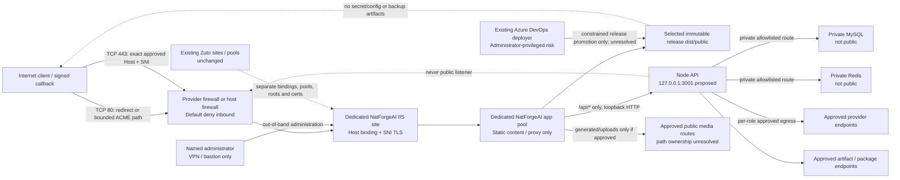

# R10-A A06 network, IIS and reverse-proxy security specification

Status: DOCUMENTED TARGET; NOT CONFIGURED OR LIVE-VERIFIED. Frozen baseline `799f6b4cb351ebe969f97da606324605fdf2a07b`; branch `feature/r10-a-production-platform`. A06 is the mission stage label. This scope maps primarily to local planning requirement A05 (IIS/network/TLS); it does not renumber local A01-A16 or D01-D12, and does not close the remaining identity requirements in A06. See [A01 baseline](r10-a-a01-platform-baseline.md), [A01 requirements](r10-a-a01-requirements.md), [decisions](r10-a-a01-decisions.md), [A02 architecture](r10-a-a02-platform-architecture.md), [A04 identity model](r10-a-a04-identity-permissions.md), [A05 secrets](r10-a-a05-secrets-management.md), [A06 sources](r10-a-a06-sources.json), and [A06 report](r10-a-a06-network-security-report.md).

## 1. Evidence boundaries

Evidence labels: `M6` = current operator-supplied verified platform and domain facts; `REPO` = static inspection of frozen-baseline files; `CONTRACT` = sibling R10 contract requirements; `TARGET` = proposed design; `UNKNOWN` = no evidence or approval yet. This document makes no claim that NatForgeAI has an IIS site, certificate, proxy module, firewall rule, DNS record change, or deployed process.

| Fact or finding | Evidence and limit |
|---|---|
| Host TNN05-WIN1 is Windows Server 2022 Standard; IIS is running with hostname-specific Zuto sites and SNI HTTPS bindings | M6; current bindings, modules, global settings and certificate ACLs were not inspected in this stage |
| Public IPv4 `41.185.71.10` is assigned | M6; reachability and firewall/NAT behavior not tested |
| `natforgeai.com` and `www.natforgeai.com` currently point to `104.37.190.42`; DNS is editable at Afrihost but cutover is unauthorized | M6; zone record types, TTLs, MX/mail/wildcard and DNSSEC state were not accessed or independently checked |
| Node.js 26.13.0 and npm 11.20.0 are installed; no NatForgeAI IIS site or TLS certificate exists | M6; no deployment or host access in A06 |
| `api/boot.ts` production listener uses `127.0.0.1` and `PORT || 3001`; `public/web.config` rewrites `/api/*`, `/generated/*`, `/uploads/*` to `127.0.0.1:3001` | REPO; port alignment is a recorded planning direction, not an installed listener or approved final override policy |
| `api/boot.ts` applies Hono `bodyLimit` of `50 * 1024 * 1024` bytes | REPO; IIS and route-specific upload limits have not been configured or measured |
| `public/web.config` serves as a proposed SPA rewrite/cache file; it contains no visible HTTPS redirect, request filtering, forwarded-header trust policy, HSTS/security headers, or `/videos` proxy | REPO; no inference about IIS server-level configuration |
| Boot contains no explicit forwarded-header or proxy-trust middleware in the inspected entrypoint; static search found no WebSocket endpoint in the inspected application code/package dependencies | REPO; review all future endpoint/adapters before deciding proxy support is unnecessary |
| F-CONTRACT §8 requires TLS 1.2+, HTTPS, HSTS, default-deny inbound, private DB/Redis, proxy-only API, restricted egress and remote admin through VPN/bastion; E-PLATFORM §2/§4 requires certificate and service evidence | CONTRACT; requirements are not host implementation or completed acceptance |

Microsoft references support configuration concepts, not facts about this host: [IIS site binding and SNI flags](https://learn.microsoft.com/en-us/iis/configuration/system.applicationHost/sites/site/bindings/binding), [ARR and URL Rewrite reverse proxy](https://learn.microsoft.com/en-us/iis/extensions/url-rewrite-module/reverse-proxy-with-url-rewrite-v2-and-application-request-routing), [IIS request limits](https://learn.microsoft.com/en-us/iis/configuration/system.webserver/security/requestfiltering/requestlimits/), and [response headers with URL Rewrite](https://learn.microsoft.com/en-us/iis/extensions/url-rewrite-module/modifying-http-response-headers). Server-level proxy enablement and existing Zuto behavior need an impact review before any future change.

## 2. Target network and site topology

The intended public edge is IIS on 80/443 only. Port 80 serves a hostname-validated redirect to the selected HTTPS canonical host or the minimum ACME HTTP-01 challenge path if that certificate method is explicitly chosen. HTTPS terminates at IIS/HTTP.sys. IIS proxies approved dynamic routes to Node over loopback only. Node does not bind to a public interface. The target Node port is **127.0.0.1:3001**, matching both boot default and existing rewrite. `PORT` override, if retained, must be one approved setting consumed by the listener, IIS rewrite, local readiness check, and operator evidence; no component may silently assume a different value. F-CONTRACT §8's generic port 3000 remains a recorded variance for D01/F/X reconciliation, not authority to change source or host now.

Use one dedicated NatForgeAI IIS site, application pool, physical path to the currently selected immutable release's `dist/public`, and NatForgeAI-specific logs. Allocate explicit HTTP and HTTPS host bindings only for approved names. `natforgeai.com` is the primary candidate. `www.natforgeai.com` may be a second SNI host binding on the same isolated site/certificate only after the host/certificate/DNS owners approve it; whether it serves or redirects canonically remains OPEN. Do not create a catch-all/default-host rule. Reject unknown Host values and requests for Zuto aliases at both IIS and application layers. Ensure fallback/default sites cannot capture NatForgeAI hostnames and NatForgeAI bindings cannot shadow existing Zuto bindings.

For HTTPS, require hostname-specific SNI bindings and a publicly trusted, name-valid certificate whose private key is accessible only to the authorized IIS/HTTP.sys use and certificate-renewal authority. Prefer separate lifecycle/renewal records from Zuto; do not modify, borrow, rebind, export, or replace Zuto certificates or win-acme renewal definitions. Choose certificate challenge method (HTTP-01, DNS-01, or other supported approved method), issuance owner, renewal identity, alert window and failure escalation before launch. Test renewal in the authorized path and prove Zuto renewal remains unchanged. Certificate issuance, binding and renewal are live gates, not done here.

IIS serves only the SPA from the selected read-only release. Disable directory browsing; deny dotfiles, configuration, environment files, source maps if not approved, backup/archive/temp files, logs, secret files and non-SPA paths. The web root must not contain private media, credentials, backup data or writable runtime paths. Set the dedicated app pool identity to minimum static/proxy access only; do not grant `IIS_IUSRS`, Zuto pools or anonymous `IUSR` broad reads. The selected release should be immutable to the pool and runtime; paths/ACLs are defined in A04 and remain unprovisioned.

## 3. Rewrite, proxy and request trust

The frozen `public/web.config` rules proxy `/api/{path}`, `/generated/{path}` and `/uploads/{path}` to `http://127.0.0.1:3001`; SPA fallback comes last and cache rules disable cache for the root static content while caching `/assets` for one year. Treat these as source proposals only. Route ownership and public/private-media authorization remain unresolved under D04; `/videos` is not currently proxied by this file and must not be silently added by an infrastructure rule. Coordinate any app route/media changes through X; no application implementer is appointed.

Before using ARR/URL Rewrite, verify installed module names/versions, proxy enablement and scope, request/response header behavior, and all existing global and site-level Zuto rules. ARR proxy enablement may be server-level; do not change it without documented change impact, backup of current IIS configuration, Zuto regression evidence and an approved rollback. Use site-scoped exact route rules, not a global wildcard proxy. Prevent proxy loops and reject encoded traversal, double-decoding, path separator tricks, invalid verbs, malformed host values and unapproved methods. The API route set remains application-owned; IIS filtering is defense in depth, not an authorization replacement.

At the edge, discard client-supplied `Forwarded` and `X-Forwarded-*` values and write a canonical set from IIS's validated request context. Preserve the approved public Host when needed for OAuth callbacks and absolute URL construction; set scheme to `https` only when the client arrived through the trusted TLS binding. Since Node receives local proxy traffic, the application may trust forwarding metadata only from the exact loopback proxy boundary and only after the external header was overwritten. Never trust arbitrary `X-Forwarded-Host`, `X-Forwarded-Proto`, or client-IP chains. Validate Host against the approved domain allowlist at IIS and app. The inspected boot does not configure trusted-proxy handling: secure scheme, client IP, redirect URI and cookie behavior need app-level owner assignment/test before production. Loopback port secrecy is not authentication; other local processes can connect, so preserve API authentication, webhook signatures and tenant authorization.

Do not terminate TLS at Node for this topology. Public HTTP redirects must not use unvalidated Host to construct the destination. Prevent redirect loops by making the trusted external HTTPS indication explicit. Set secure cookies only after effective-HTTPS behavior is confirmed. For inbound provider webhooks, proxy raw request bodies unchanged and preserve signature headers; do not decompress, normalize, rewrite, or log body content before application verification.

## 4. TLS, headers, verbs, payloads and timeouts

- Enforce TLS 1.2 or later at IIS/HTTP.sys per F-CONTRACT §8, with secure supported cipher/protocol policy and no plaintext application route. TLS 1.3 may be enabled after Windows/IIS client compatibility and policy review. Exact cipher suite list is host/security-owner controlled and not supplied here.
- Redirect HTTP to the selected HTTPS hostname. Do not enable HSTS until the HTTPS binding, certificate, canonical-host redirect and all relevant subdomains have been verified. Start with the approved host scope and short controlled max-age, then increase only under security-owner approval; do not add `includeSubDomains` or preload until every affected name is committed to HTTPS.
- Assign one layer for each response security header to avoid contradictory duplicates. At minimum, security review must set appropriate HSTS after TLS readiness, `X-Content-Type-Options`, `Referrer-Policy`, a tested `Content-Security-Policy`/frame policy and `Permissions-Policy`; CSP values require frontend/provider/OAuth compatibility testing and must not be guessed. Remove framework/version banners where supported. Cookies need `Secure`, `HttpOnly` and a flow-compatible `SameSite` policy; session code owner and cross-site OAuth/webhook behavior must be tested. `web.config` currently supplies no such headers.
- Define a route-specific allowed verb policy: SPA GET/HEAD; API methods supported by tRPC and explicit OAuth/webhook methods; reject TRACE and unneeded methods. Do not break OAuth callbacks or signed POST webhooks. Review `allowMethodOverride: true` in boot as an application-level method-override risk; proxy must not broaden it, and owner approval/code remediation may be needed.
- Hono's current global request body limit is 50 MiB (`52,428,800` bytes). IIS request filtering/ARR must have an explicitly reviewed bound consistent with this effective app ceiling and justified smaller per-route limits where feasible; account for multipart and webhook needs. IIS's actual configured `maxAllowedContentLength`, query, URL and header limits are UNKNOWN. Do not assume IIS defaults are adequate: Microsoft documents a default content limit of 30,000,000 bytes, smaller than this application's current cap. Any intended change to app size limit is unassigned application work; no final IIS value is approved here.
- Set bounded proxy connection, idle/read and send timeouts per route based on measured API response budgets and client/provider contracts. Do not use an unbounded proxy timeout; do not terminate legitimate long requests without deciding whether they need asynchronous job polling. No timeout values are set by the cited contracts, so values remain OPEN until measured and signed off.
- No WebSocket endpoint was identified in the inspected app. WebSocket support is therefore not required for the documented baseline. If a later code/provider feature requires Upgrade, explicitly enable and test IIS WebSocket Protocol and ARR upgrade forwarding, connection limits, authentication and idle timeout; do not enable it speculatively.

## 5. Firewall and egress policy

| Flow | Target policy | Evidence required later |
|---|---|---|
| Public inbound to host | Default deny. Permit TCP 443 to IIS; TCP 80 only for approved redirect/ACME need. Host header/SNI routes to NatForgeAI or existing site-specific bindings | Provider and Windows firewall rules, external port scan, Zuto regression |
| Public inbound to Node | Deny all external access to 3001 and any other app port; listener must bind only `127.0.0.1` | Socket binding inspection and external plus local denied-operation probes |
| Public inbound to MySQL/Redis | Deny all public access, including host port exposure; use private network or loopback/local private boundary only | Actual endpoint, routing, TLS/auth and source allowlist evidence; ports are service-defined and currently unknown |
| Administration | No public RDP/SSH or management console. Named admin uses approved VPN/bastion/private management plane with MFA, source allowlist and audit; emergency access is independent of runtime and deployment | Provider ACLs, host firewall, identity and audit drills; no IPs/accounts assumed |
| IIS to Node | Loopback HTTP only for approved route set. No non-loopback bind and no second proxy bypass | Listener and IIS config review; health/readiness must use approved side-effect-free checks |
| API/worker/scheduler to data services | Outbound access only to approved private DB/Redis endpoints, ports and TLS/auth policy; no public database/queue endpoint | D06 decision and connection/source firewall evidence |
| Runtime provider egress | Default deny except named, enabled providers/endpoints and required callbacks/service dependencies; use per-role egress where possible. No open-ended internet access or user-supplied destination bypass | Provider roster and host/network egress policy; D/F/X security review |
| Deployment and operations | Permit only approved source-control/artifact feeds, time/DNS, telemetry, backup and certificate-validation destinations required by their own identities/processes | D02/D07/D08/D09/D10 decision and traffic test; no runtime inheritance of deployment/backup credentials |

Exact private addresses, DB/Redis ports, provider endpoint set, DNS resolvers, NTP service and upstream firewall/NAT controls are UNKNOWN. Build an allowlist from actual enabled features and provider documentation; don't infer it from default env variable names. A shared host may require Windows Firewall plus OneGrid edge rules; inspect and coordinate both. Egress filtering must account for certificate renewal, OS security updates, artifact delivery, alert delivery, monitoring and backup without granting API arbitrary destination access (website-analyser user-supplied URL path remains an SSRF/security review dependency from F).

## 6. DNS cutover and rollback safety

Current supplied facts are that Afrihost DNS for both `natforgeai.com` and `www.natforgeai.com` points to `104.37.190.42`, and change is **not authorized**. Before any later cutover:

1. Obtain zone-owner approval and an authoritative current-zone export with record type, name, value, TTL and DNSSEC state. Identify apex A/AAAA/ALIAS/ANAME and `www` A/AAAA/CNAME, all MX and mail-related TXT (SPF/DKIM/DMARC), wildcard, ACME challenge, verification, CAA and unrelated records. This stage did not inspect or reproduce any of those records.
2. Approve canonical host behavior (apex vs `www`), certificate names/chain/renewal method, public IIS 80/443 readiness, trusted forwarded HTTPS behavior, app readiness, egress/provider posture, backup/rollback plan and support window. Certificate must be valid for each exposed hostname before cutover. Avoid certificate challenge or redirect choices that require premature public routing.
3. Decide TTL reduction with zone owner in advance, preserving existing values until explicitly approved. Change only the exact approved web-record set; preserve MX, mail, wildcard, verification and unrelated records byte-for-byte unless their owners separately authorize a change. Do not change registrar, nameservers, mail routing or DNSSEC in this application cutover.
4. Capture pre-change zone snapshot and rollback values out of band. Change only apex and/or `www` records approved to point to `41.185.71.10`. Do not add AAAA unless IPv6 routing/firewall/IIS/certificate behavior has been verified and approved. Verify authoritative and recursive DNS, TLS/SNI for each host, redirects, static/API route, webhook/OAuth URLs, logs and alerts; monitor old and new hosting during TTL/cache overlap.
5. Roll back only the approved web records to the recorded prior values if gates fail, keeping mail and unrelated records unchanged. Record propagation limits and rollback authority; do not equate DNS rollback with revoking credentials, undoing external effects or reactivating autonomy.

DNS cutover is a distinct D08 approval and later live gate. Nothing in A06 changes DNS.

## 7. Acceptance tests and traceability

These are specifications only. No test, server query, IIS configuration export or DNS lookup was performed. Every local A01-A16 and D01-D12 identifier is retained as a planning cross-reference, not a historical source ID.

| Local planning ID | A06 relevance / evidence expected |
|---|---|
| A01 | Baseline/traceability: cite M6 facts and distinguish host evidence from REPO/CONTRACT/TARGET |
| A02 | Host isolation: dedicated IIS site/pool/root and safe coexistence with Zuto |
| A03 | Release/media routes: immutable SPA root, approved proxy routes, private/public media classification; `/videos` and application changes unresolved |
| A04 | Package boundary: no backup, secret, `.env`, diagnostic or mutable runtime content in web/release root |
| A05 | Primary requirement: IIS, hostname/SNI, TLS, proxy, firewall, egress, DNS and admin network specification (A06 stage document) |
| A06 | Identity: dedicated pool vs Node tokens, proxy process and admin isolation; detailed accounts/ACL evidence remains A04/D05 scope |
| A07 | Secrets: no secret in IIS config/proxy/header/log; TLS key and certificate renewal access per A05/D07-D08 |
| A08 | API supervision: common 3001 setting across listener/rewrite/readiness; side-effect-free readiness is still open from A03 |
| A09 | Worker/scheduler: no public listener; per-role egress and data routes; process topology remains A03/D02 |
| A10 | Data: MySQL/Redis private-only and nonpublic; endpoint/grant/TLS choices remain D06 |
| A11 | Providers: outbound allowlist and verified callbacks; provider roster and adapters remain D/F/X gates |
| A12 | Telemetry: certificate, IIS, API and firewall evidence with absent data UNKNOWN; collectors/alerts remain D09/E |
| A13 | Backup: no public route or web-root artifact; backup egress and protected destination remain D10/G |
| A14 | Independent stop: admin/stop channel is out-of-band and runtime cannot clear it; D11/H control unimplemented |
| A15 | Release/cutover/rollback: exact DNS snapshot, IIS binding rollback and app rollback gates; no activation here |
| A16 | Evidence: independent approvals, complete gates and authorized live verification required; none inferred |

| Local decision ID | Current disposition / closure evidence required |
|---|---|
| D01 | Keep isolated IIS/SNI and proposed loopback 3001; reconcile F's generic 3000, approve canonical hostname(s), exact binding and common port source |
| D02 | Supervisor/probe path must share approved port and pass no-write liveness/readiness semantics; product and safe probe unresolved |
| D03 | Selected immutable `dist/public` release path and rollback semantics; concrete path/pointer remains open |
| D04 | `/generated` and `/uploads` are baseline proxy routes; privacy, absolute media roots, `/videos`, import and route changes require application owner assignment via X |
| D05 | Dedicated app pool, Node, deployment and admin identities; effective ACL and IIS anonymous-auth policy require approval/live proof |
| D06 | Private DB/Redis placement, exact ports, TLS/auth and allowlists remain unselected |
| D07 | Proxy/service environment, certificate key and admin-agent boundaries must use approved secret controls; secret-store/supervisor unresolved |
| D08 | Certificate issuance/renewal, apex/www canonicalization, exact DNS records, TTL and cutover/rollback authority remain OPEN |
| D09 | IIS/API/cert/firewall telemetry, thresholds and alert delivery require E/A/X binding; no live signal claimed |
| D10 | Backup/offsite egress and management routes remain G/A/X; no access from web/runtime to backup storage |
| D11 | Independent H stop/admin channel remains outside public/runtime and cannot be changed by proxy, deploy or Node |
| D12 | A owns platform specification; A/X integration, app header/route owner, host/DNS/cert approvers and final signatories remain explicitly unresolved |

### Offline acceptance (specified now; checks below performed)

- Cross-reference every A01-A16 and D01-D12 planning identifier; distinguish source facts, repository behavior, proposal and unknown.
- Confirm port 3001 references agree across `api/boot.ts` and `public/web.config`, and F §8's 3000 variance remains visible.
- Confirm proposed ingress denies direct Node, DB and Redis exposure; Zuto isolation and DNS no-change are explicit.
- Confirm no unsupported numeric timeout, firewall source, certificate issuer, proxy header implementation or WebSocket feature is represented as existing/approved.
- Validate document-local links, JSON catalog, source hashes and `git diff --check`.

### Later live acceptance (NOT RUN)

1. Export and review existing IIS sites, bindings, app pools, ARR/Rewrite versions/global proxy state, request filtering, modules, certificates and certificate renewal tasks. Prove Zuto configuration/certs unchanged after any approved work.
2. Verify exact hostname/SNI certificate selection for apex and approved `www`, HTTP redirect/challenge behavior, TLS policy, HSTS state and renewal alert. Check unknown Host/SNI is rejected, no default-site leak occurs, and HTTP never exposes authenticated/content routes.
3. Prove Node binds only `127.0.0.1:<approved-port>`; external and non-loopback probes to API, DB and Redis fail. Verify IIS can reach only intended API routes; no direct public API/service port exists.
4. Test that spoofed forwarding headers, host injection, encoded traversal, alternate verbs, malformed requests, proxy loops and request-size excess are rejected. Verify legitimate OAuth redirects and raw signed webhook bodies remain valid. Exercise body-size and proxy timeout boundaries using synthetic data.
5. Confirm static release root is read-only and contains no secrets/backups/temp files; media paths resolve only as approved and private media cannot be served anonymously. Confirm `/videos` remains unavailable until assigned and approved.
6. Verify actual host/edge inbound and outbound rules: only approved public 80/443; DB/Redis private; provider egress allowlisted; no public RDP/SSH; admin path VPN/bastion/MFA/audit. Exercise deny cases and capture evidence without altering Zuto.
7. Validate response headers, secure cookies, CSP, CORS/host policy, HTTP/HTTPS behavior and app authorization; verify no harmful duplicate/conflicting headers. WebSocket test only if an approved feature requires it.
8. With DNS owner approval only, verify zone snapshot, TTL, certificate and mail/wildcard preservation; test cutover and rollback on an approved schedule. No DNS action is part of this specification.

All live acceptance remains OPEN/NOT RUN. A06 documentation cannot authorize configuration or cutover.

## 8. Ownership and remaining decisions

A owns platform specification and later separately authorized IIS/network/certificate/firewall/DNS runbook work. F owns the security policy; D owns provider semantics; E owns telemetry definitions; C/H retain runtime/stop semantics; X coordinates integration and any unassigned application work but is not silently appointed as its code implementer or sole activation approver. Application changes for trusted forwarded headers, host/scheme handling, redirect/cookie behavior, `/videos` and media authorization, API route limits and side-effect-free health are unassigned until an authoritative owner accepts them through X. Host, firewall, certificate and DNS approval authorities are also not identified in the source evidence.

Open items: D01 port and hostname finalization; D02 supervisor and readiness; D04 route/public-media ownership; D05 exact account and ACL policy; D06 DB/Redis endpoints; D07 secret source and deployment boundary; D08 certificate/challenge/renewal/DNS authority; D09 telemetry; D10 backup egress; D11 independent control; D12 signatories. Current NAT/edge rules, IPv6, ARR modules/settings, certificate store/key ACL, IIS global state, endpoint addresses/ports, DNS zone records, TTL, DNSSEC and security-header values are UNKNOWN. No approval is inferred.

**Stop after A06. Do not begin A07.**
